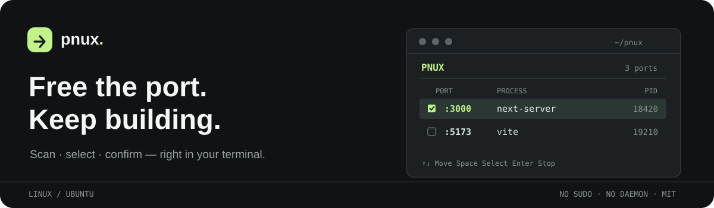
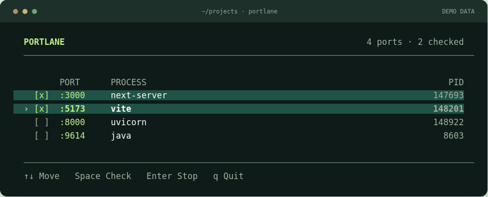
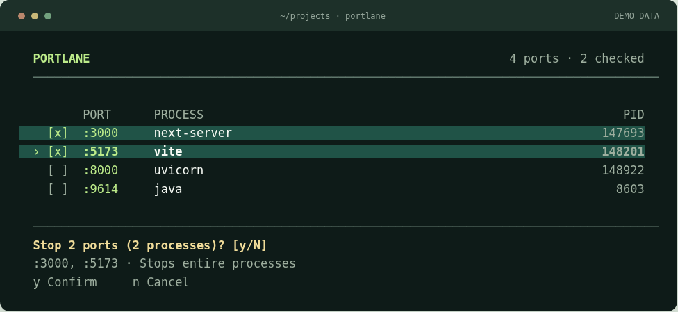

<div align="center">
  <a href="https://luan-thnh.github.io/portlane/"></a>
  <h1>Portlane</h1>
  <p><strong>Find the port. Select the process. Get back to building.</strong></p>
  <p>
    <a href="https://luan-thnh.github.io/portlane/">Website</a> ·
    <a href="README.vi.md">Tiếng Việt</a> ·
    <a href="#quick-start">Quick start</a> ·
    <a href="PUBLISHING.md">Publishing guide</a>
  </p>
  <p>
    <a href="https://github.com/luan-thnh/portlane/actions/workflows/pages.yml"></a>
    
    
    <a href="LICENSE"></a>
  </p>
</div>



> **Illustration:** example ports and process IDs shown above are not real processes on your machine.

Portlane is a small, keyboard-first **Linux port manager**. It shows the listening ports you can manage, with the **port number first**, the process name next, and technical details out of the way. Select several rows with Space; stop only after confirming.

## Quick start

```bash
npx portlane-tui
```

**npm release is pending.** The command above works *after* the maintainer publishes `portlane-tui` to npm. The package named `portlane` belongs to a different project; do not use `npx portlane` for this tool.

**Run from source today** (Linux/Ubuntu, Node.js 20+, normal user):

```bash
git clone https://github.com/luan-thnh/portlane.git
cd portlane
npm start
```

Or install a local global command with `npm link`, then run `portlane`. No external runtime dependencies or daemon.

## See it in action

<p align="center"></p>
<p align="center"><sub>Focused port-first table · <kbd>Space</kbd> to select multiple rows</sub></p>
<p align="center"></p>
<p align="center"><sub>Review before sending one graceful SIGTERM per unique process</sub></p>

| Key | Action |
| --- | --- |
| <kbd>↑</kbd> / <kbd>↓</kbd> or <kbd>j</kbd> / <kbd>k</kbd> | Move |
| <kbd>Space</kbd> | Select / unselect a row |
| <kbd>Enter</kbd> | Review selected rows (or current row) |
| <kbd>Y</kbd> / <kbd>N</kbd> | Confirm / cancel |
| <kbd>R</kbd> | Refresh |
| <kbd>Q</kbd> | Quit |

### Read-only CLI

```bash
portlane --list          # Manageable listening ports
portlane --list --mine   # Current-user sockets and protection status
portlane --list --all    # All visible sockets
portlane --json          # Machine-readable output
portlane --udp --list    # Include UDP
```

## Built to be careful

- **User-owned processes only** in the interactive stop list; root, other-user and protected processes are excluded.
- **Explicit confirmation** before sending any signal.
- **Revalidation** of process identity and socket mapping immediately before a stop.
- **SIGTERM**, never automatic SIGKILL; one signal per unique PID.
- **No sudo, no background service, no firewall edits.**

> **Important:** stopping a port means signaling the *entire process* listening on it. A single process may serve multiple ports or hold unsaved work. The safety checks reduce mistakes, but cannot guarantee every user process is harmless to stop.

## Contribute & deploy

```bash
npm test
npm run pack:check
```

The landing page is static HTML, CSS and JavaScript in [`docs/`](docs/). View locally with `python3 -m http.server 8080 --directory docs`. Its interactive terminal is a **demo only** and never touches your computer's ports.

**GitHub Pages:** in **Settings → Pages**, select **Deploy from a branch → main → /docs → Save**. Alternatively select **Source → GitHub Actions** to let the [workflow](.github/workflows/pages.yml) deploy `docs/`. The workflow runs tests but **never publishes npm**; only the maintainer does that, following [PUBLISHING.md](PUBLISHING.md).

Inspired by [npkill](https://github.com/voidcosmos/npkill)'s focused TUI. Portlane's port management logic is an independent implementation. [MIT License](LICENSE).
