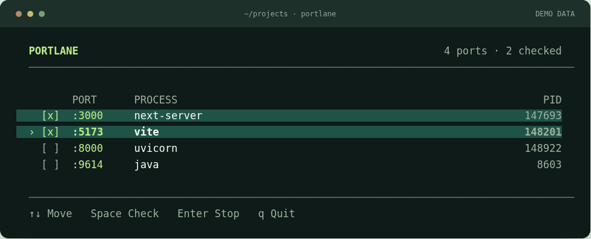
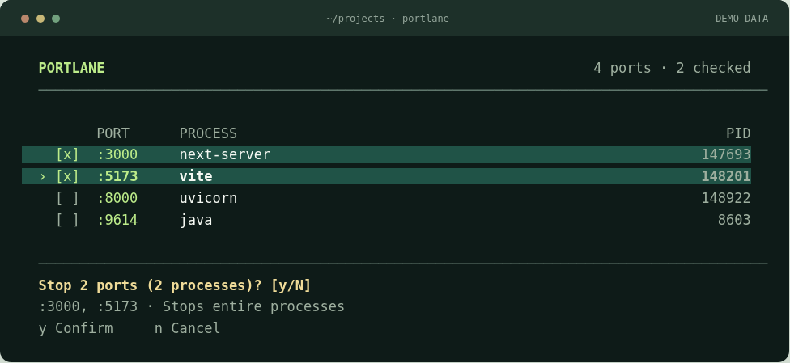

<div align="center">
  
  <h1>Portlane</h1>
  <p><strong>Quản lý port, không rườm rà.</strong></p>
  <p>Quét port đang chạy, chọn một hoặc nhiều port, xác nhận trước khi dừng.</p>
  <p><a href="README.md">English README</a> · <a href="site/index.html">Landing page</a></p>
</div>



*Ảnh minh họa được tạo từ bộ dựng giao diện TUI; số port, PID và tên ứng dụng chỉ là dữ liệu mẫu.*

## Tính năng

- Bảng gọn: **PORT** ở đầu, **PROCESS** ở giữa, PID nhỏ bên phải (ẩn PID nếu terminal quá hẹp).
- Dùng `↑↓` để di chuyển, `Space` để chọn nhiều port, `Enter` để xem xác nhận `y/n`.
- Chỉ đề xuất dừng tiến trình của tài khoản hiện tại vượt qua các kiểm tra an toàn.
- Gộp socket IPv4/IPv6 cùng một port và một tiến trình.
- Không cần `sudo`, không có service chạy nền, không tự dừng tiến trình.
- Không cần cài thư viện npm bên ngoài.

## Cài đặt

Sau khi chủ dự án phát hành package **`portlane-tui`** lên npm, bạn có thể chạy:

```bash
npx portlane-tui
```

> **Chưa publish npm.** Đây là lệnh dự kiến sau khi phát hành, không phải lệnh chạy ngay hôm nay. Tên package `portlane` đã thuộc một dự án khác, nên `npx portlane` không chạy CLI này.

**Yêu cầu:** Linux/Ubuntu và Node.js 20+, chạy bằng tài khoản thông thường.

Portlane **chưa được phát hành trên npm Registry**. Sau khi giải nén source ZIP:

```bash
cd portlane-tui
npm link
portlane
```

Hoặc chỉ chạy trong thư mục source:

```bash
npm start
```

## Phím tắt

| Phím | Thao tác |
| :-- | :-- |
| `↑` / `↓` hoặc `j` / `k` | Di chuyển |
| `Space` | Chọn / bỏ chọn port |
| `Enter` | Đề nghị dừng port đã chọn; nếu chưa chọn thì dùng dòng hiện tại |
| `y` | Đồng ý dừng |
| `n` / `Esc` | Hủy xác nhận |
| `r` | Quét lại |
| `q` / `Esc` | Thoát (khi không có hộp xác nhận) |



Nếu nhiều port thuộc cùng một PID, chương trình chỉ gửi **một lần `SIGTERM`** cho PID đó.

## Lệnh xem thông tin (chỉ đọc)

```bash
portlane --list
portlane --list --mine
portlane --list --all
portlane --json
portlane --udp --list
portlane --help
```

Mặc định chỉ quét TCP đang lắng nghe. Có thể thêm UDP bằng `--udp`. Các chế độ đọc nâng cao **không** cho phép dừng các tiến trình được bảo vệ.

## An toàn

Portlane chỉ đọc `/proc` khi quét; không chỉnh firewall hay xóa file. Trước khi gửi tín hiệu, nó kiểm tra lại chủ sở hữu, thời điểm bắt đầu tiến trình, executable và socket để giảm nguy cơ PID bị tái sử dụng. Các tiến trình root, người dùng khác, không xác định, tiến trình hệ thống/desktop thuộc danh sách bảo vệ và tiến trình tổ tiên bị chặn.

**Lưu ý quan trọng:** "Dừng port" thực chất là dừng **toàn bộ tiến trình** đang sở hữu port. Nếu ứng dụng dùng nhiều port, tất cả dịch vụ của nó có thể ngừng hoạt động. Việc bảo vệ giúp giảm rủi ro chứ không cam kết mọi tiến trình người dùng đều an toàn để dừng.

## Phát triển và kiểm thử

Chủ dự án có thể xem [PUBLISHING.md](PUBLISHING.md#publish-to-npm-manually-maintainers-only) để tự phát hành npm: `npm login` → `npm test` → `npm run pack:check` → `npm publish --access public`. GitHub Actions **không** tự publish npm.

```bash
npm test
npm run pack:check
```

Website nằm trong `site/`; có thể xem trực tiếp file `site/index.html` hoặc chạy:

```bash
python3 -m http.server 8080 --directory site
```

Landing page chỉ mô phỏng thao tác chọn/dừng bằng dữ liệu mẫu, **không** tác động đến máy của người truy cập. Để đưa lên GitHub Pages, push lên nhánh `main`, vào **Settings → Pages → GitHub Actions**, sau đó chạy workflow **Deploy landing page**.

Dự án được lấy cảm hứng từ trải nghiệm TUI của [npkill](https://github.com/voidcosmos/npkill) nhưng mã xử lý port là độc lập. Giấy phép [MIT](LICENSE).

## Triển khai GitHub Pages

- Tạo repository **public** `luan-thnh/portlane` rồi đẩy source lên nhánh `main`.
- Trong **Settings → Pages**, chọn **Source → GitHub Actions**.
- Workflow [Test and deploy GitHub Pages](.github/workflows/pages.yml) chạy test và kiểm tra gói npm trước khi deploy nội dung `site/`.
- Sau khi workflow thành công, địa chỉ dự kiến là `https://luan-thnh.github.io/portlane/`.
- **Không có bước tự động publish npm**; chủ dự án tự publish khi muốn.


## Giao diện landing page

Landing page trong [`site/`](site/) có **chế độ sáng/tối**, nút chuyển đổi ở thanh điều hướng và tự nhớ lựa chọn trên trình duyệt. Nếu chưa từng chọn, trang sử dụng thiết lập giao diện của hệ điều hành. Hiệu ứng nhẹ, tôn trọng `prefers-reduced-motion`. Demo terminal chỉ là dữ liệu minh hoạ, không thao tác với tiến trình thật.
