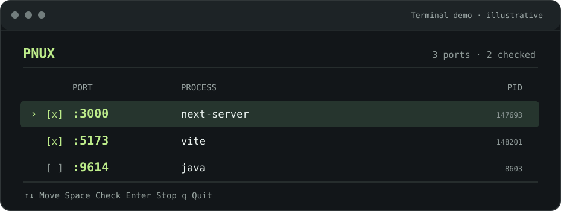
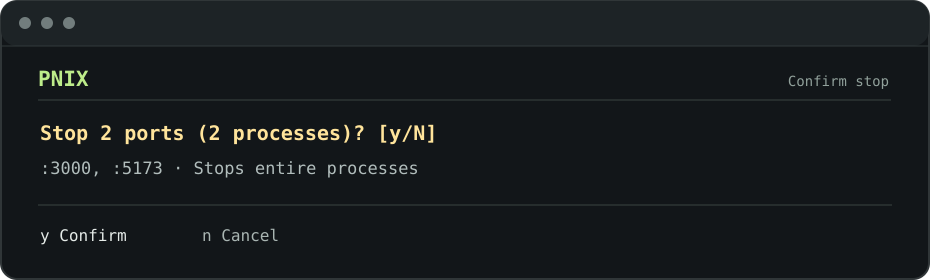

<div align="center">
  <a href="https://luan-thnh.github.io/pnux/"></a>
  <h1>PNUX</h1>
  <p><strong>Thấy port ngay. Chọn nhanh. Dừng có xác nhận.</strong></p>
  <p><a href="https://luan-thnh.github.io/pnux/">Website</a> · <a href="README.md">English</a> · <a href="#chạy-thử">Bắt đầu</a></p>
</div>


> Banner và các ảnh TUI dùng dữ liệu minh họa, không phải tiến trình thực tế.

**PNUX** là công cụ quản lý port cho Linux/Ubuntu. Giao diện bảng ưu tiên **PORT**, tiếp đến tên ứng dụng; hỗ trợ chọn nhiều bằng <kbd>Space</kbd> và xác nhận <kbd>Y/N</kbd> trước khi dừng.

## Chạy thử

Sau khi chủ dự án phát hành npm:

```bash
npx pnux9
```

**Package `pnux9` chưa được publish lên npm.** Sau khi bạn tự publish, lệnh `npx pnux9` mới chạy được. Hiện tại có thể chạy từ source ở bên dưới.

Chạy ngay từ source (Node.js 20+, Linux, tài khoản thường):

```bash
git clone https://github.com/luan-thnh/pnux.git
cd pnux
npm start
```

Nếu muốn dùng lệnh `pnux9` (hoặc alias `pnux`) trên máy: chạy `npm link` trong thư mục dự án.

## Giao diện thực tế

<p align="center"></p>
<p align="center"><sub>PORT · PROCESS · PID, chọn nhiều bằng Space</sub></p>
<p align="center"></p>

| Phím | Tác dụng |
| --- | --- |
| <kbd>↑↓</kbd> / <kbd>j k</kbd> | Di chuyển |
| <kbd>Space</kbd> | Chọn / bỏ chọn port |
| <kbd>Enter</kbd> | Xem xác nhận dừng |
| <kbd>Y</kbd> / <kbd>N</kbd> | Đồng ý / hủy |
| <kbd>R</kbd> | Quét lại |
| <kbd>Q</kbd> | Thoát |

### Xem thông tin (không kill)

```bash
pnux9 --list
pnux9 --list --mine
pnux9 --list --all
pnux9 --json
pnux9 --udp --list
```

## Cơ chế an toàn

- Chỉ cho dừng tiến trình đủ điều kiện thuộc người dùng hiện tại; bảo vệ tiến trình hệ thống, root và người dùng khác.
- Kiểm tra lại PID, chủ sở hữu và socket ngay trước khi gửi tín hiệu.
- Luôn xác nhận; dùng `SIGTERM`, không tự nâng lên `SIGKILL`.
- Không cần sudo, không có daemon, không sửa firewall hay file hệ thống.

> **Lưu ý:** Dừng port thực chất là dừng **toàn bộ tiến trình** sở hữu port. Nếu một PID có nhiều dịch vụ, chúng có thể dừng cùng lúc; công cụ không thể bảo đảm an toàn tuyệt đối.

## Phát triển và GitHub Pages

```bash
npm test
npm run pack:check
```

Landing page tĩnh ở [`docs/`](docs/), có Dark/Light Mode, animation nhẹ và demo terminal minh họa. Chạy local bằng `python3 -m http.server 8080 --directory docs`.

Tại **Settings → Pages**, chọn **Deploy from a branch → main → /docs → Save**. Hoặc chọn **Source → GitHub Actions** để workflow tự triển khai. Hướng dẫn tự publish npm: [PUBLISHING.md](PUBLISHING.md) — GitHub Actions **không publish npm**.

Lấy cảm hứng từ TUI của [npkill](https://github.com/voidcosmos/npkill), sử dụng phần xử lý port độc lập. [Giấy phép MIT](LICENSE).
